  

&nbsp;

&nbsp;

&nbsp;

📍 Bavaria, Germany &nbsp;·&nbsp; 🗣️ English · French &nbsp;·&nbsp; 🎓 B.Sc. Applied AI, Oct 2026

---

I build end-to-end AI systems, from multi-agent LLM pipelines to production ML. I lean toward **local, privacy-preserving inference** and evaluation I can defend with numbers. I'm a final-year Applied AI student (Pristini School of AI, Tunisia), finishing my thesis at **OTH Amberg-Weiden** in Germany.

> **Open to junior AI / ML engineering roles from late 2026**, especially LLM agents, applied ML and GenAI in production. The fastest way to reach me is [email](mailto:bcrtob@gmail.com) or [LinkedIn](https://www.linkedin.com/in/bocar-ba-1781992b2).

### 🔭 Now

A **seven-agent LangGraph system** that links smart-home IoT sensors (Home Assistant, MQTT) with a **Pepper robot** for elderly care. Multimodal LLMs check what the sensors report before the robot acts, and all inference runs on-device.
 FastAPI · LangGraph · Ollama · MQTT · Home Assistant · Webots / Pepper

### 🧪 Selected projects

| Project | What it does | Result / proof |
|---|---|---|
| **[Bel Azur Travel](https://bel-azur-travel.vercel.app)** | Full-stack travel-booking platform with auth and a relational data model | Live on Vercel · Next.js · Prisma · NextAuth |
| **FINAIA** | Credit-risk scoring with cost-sensitive XGBoost over 24 engineered features | Default recall **49% → 80.5%**, ROC AUC 0.74 |
| **BoCare AI** | RAG medical-triage assistant (educational demo) with 5 urgency levels, EN/FR | Jailbreak detection, injection filtering, hallucination checks |
| **Prompt Engineering Assistant** | LangChain agents that generate, optimise and red-team prompts | Bias and injection testing modes · Streamlit |
| **Network Anomaly Detection** | Unsupervised intrusion detection on NSL-KDD | Isolation Forest, precision-recall-tuned modular pipeline |

Write-ups and demos → **[bocar-ba-portfolio.surge.sh](https://bocar-ba-portfolio.surge.sh)**

### 💼 Experience

- **OTH Amberg-Weiden**, AI Research Intern (thesis) · *Mar 2026 – present*: multi-agent orchestration across IoT, robotics and MLLMs
- **Ubotica Technologies**, Applied ML Intern · *Dec 2025 – Jan 2026*: CVAT datasets, few/one-shot and meta-learning (MAML) for inspection models
- **Novation City**, Generative AI Intern · *Jul – Oct 2025*: EN/FR LLM services for ESG and KPI reporting; benchmarked Gemini, Mistral and Ollama, compared direct LLM vs RAG, hardened prompts against injection
- **Pristini School of AI**, IoT Developer Intern · *Summer 2024*: ESP8266 + Firebase smart-home system with a mobile monitoring app
- **Banque Centrale de Mauritanie**, BI Intern · *2023, 2024*: financial web scraping and ETL

### 🛠️ Tech

| | |
|---|---|
| **Languages** |      |
| **GenAI / Agents** |       |
| **Machine Learning** |       |
| **Backend / Infra** |       |
| **Web / IoT** |      |

### 🧭 How I work

- **Measure first.** Every model ships with a baseline, a metric that matters to the business, and an honest error analysis.
- **Local by default.** If data is sensitive, it shouldn't leave the device. I reach for Ollama and on-prem stacks before cloud APIs.
- **Guardrails are features.** Input sanitisation, injection defences and fallbacks are part of the build, not an afterthought.

 
Mauritania → Tunisia → Germany · building AI that people can trust

