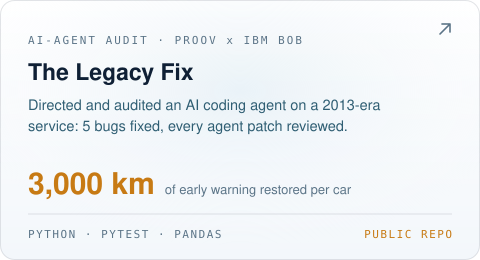

<picture>
  <source media="(prefers-color-scheme: dark)" srcset="./assets/banner-dark.svg">
  
</picture>

<a href="https://www.linkedin.com/in/bocar-ba-1781992b2"><b>LinkedIn</b></a>
&nbsp;&middot;&nbsp;
<a href="https://bocar-ba-portfolio.surge.sh"><b>Portfolio</b></a>
&nbsp;&middot;&nbsp;
<a href="https://bocar-ba-portfolio.surge.sh/cv.html"><b>CV</b></a>
&nbsp;&middot;&nbsp;
<a href="mailto:bcrtob@gmail.com"><b>Email</b></a>

Bavaria, Germany &nbsp;&middot;&nbsp; Arabic, French, English, basic German &nbsp;&middot;&nbsp; Bachelor of Applied AI, 2026

 

I build end-to-end AI systems, from multi-agent LLM pipelines to production ML. I lean toward **local, privacy-preserving inference** and evaluation I can defend with numbers. I hold a **Bachelor of Applied AI** from Pristini School of AI (Tunisia). My thesis, written in the HealthTech Research Group at **OTH Amberg-Weiden** (Germany), was defended there on 23 September 2026 with a grade of **1.3** (German scale, 1.0 is best), and at Pristini on 2 October 2026 with the mention **Excellent**.

**Open to junior AI / ML engineering roles**: LLM agents, applied ML, GenAI in production.

 

## Thesis

**Multi-Agent System for Elderly Care Home Robots in a Smart Home Environment**

Smart-home sensors can notice that an elderly person's routine has changed, but not whether it matters, so caregivers drown in false alarms. My thesis adds a verification step: before any alert or robot action, agents compare the alarm with the person's own behavioural history and a camera image, and a deterministic guardrail has the final word on anything that reaches the patient.

<a href="mailto:bcrtob@gmail.com?subject=Thesis%20walkthrough"><picture><source media="(prefers-color-scheme: dark)" srcset="./assets/now-dark.svg"></picture></a>

Results come from a pilot-scale evaluation on synthetic data and show technical feasibility, not clinical effectiveness. The code belongs to the OTH research project and is not public; I'm happy to walk you through the architecture and results, and to share code where the group allows it. <a href="mailto:bcrtob@gmail.com?subject=Thesis%20walkthrough">Get in touch</a>.

  

## Selected work

<a href="https://github.com/bcr-ba/proov-km-waechter-fix"><picture><source media="(prefers-color-scheme: dark)" srcset="./assets/card-legacyfix-dark.svg"></picture></a>
<a href="https://bocar-ba-portfolio.surge.sh/#projects"><picture><source media="(prefers-color-scheme: dark)" srcset="./assets/card-finaia-dark.svg"></picture></a>
<a href="https://bel-azur-travel.vercel.app"><picture><source media="(prefers-color-scheme: dark)" srcset="./assets/card-belazur-dark.svg"></picture></a>
<a href="https://bocar-ba-portfolio.surge.sh/#projects"><picture><source media="(prefers-color-scheme: dark)" srcset="./assets/card-bocare-dark.svg"></picture></a>

<b>The Legacy Fix in one paragraph</b>

 

A maintenance service used integer division for a ratio. It floored every partial value to zero, which silently removed the whole 80 to 99.9 percent warning window: three thousand kilometres of early warning per car, across six thousand cars (a fictional fleet built for the ProoV challenge). I found it from a failing edge case, fixed it, and locked it down with tests. I also reviewed the AI agent's patch and rejected the changes that quietly put the bug back. A follow-up analysis of 120 labelled cars showed that kilometres since last service predicts breakdowns (r = 0.40) while odometer and age, the obvious guesses, are noise; a simple risk score surfaced half of all breakdowns in the top 17% of the fleet. Every fix is a separate, explained commit: [browse the repo](https://github.com/bcr-ba/proov-km-waechter-fix/commits/main).

Also: a **Prompt Engineering Assistant** (LangChain agents that generate, optimise and red-team prompts) and **Network Anomaly Detection** (unsupervised Isolation Forest on NSL-KDD). Write-ups and demos are on the [portfolio](https://bocar-ba-portfolio.surge.sh).

**Source code:** The Legacy Fix is public. The other projects are private; if you're evaluating me for a role, [email me](mailto:bcrtob@gmail.com?subject=Source%20code%20request) with the project name and I'll share access or walk you through it.

 

## Experience

<picture><source media="(prefers-color-scheme: dark)" srcset="./assets/timeline-dark.svg"></picture>

<b>What I did in each role</b>

 

| Period | Role | Focus |
|:--|:--|:--|
| Mar – Sep 2026 | **AI Research Intern** · OTH Amberg-Weiden, HealthTech Research Group | Thesis (grade 1.3): seven-agent verification layer between smart-home sensor alarms and a Pepper robot; LangGraph, FastAPI, local Qwen2.5-VL and Llama 3.1 via Ollama, CI with GitHub Actions |
| Dec 2025 – Jan 2026 | **Applied ML Intern** · Ubotica Technologies | Turned 954 unlabelled sensor images into 3,863 defect annotations across 12 classes from written definitions only; raised inter-annotator agreement from under 75% to over 90%; YOLO / Pascal VOC exports with stratified splits |
| Jul – Oct 2025 | **Generative AI Intern** · Novation City | AI layer of a bilingual (EN/FR) Industry 4.0 and ESG assessment platform: report production from 5+ days to under 1 hour; benchmarked RAG, local models (Ollama) and Gemini; prompt A/B tests lifted stakeholder approval from 62% to 94%; prompt-injection defences |
| Summer 2024 | **IoT Developer Intern** · Pristini School of AI | Team of three: ESP8266 + Firebase smart-home scale model with temperature, gas, flame, motion, rain and light sensing, energy monitoring and gas/fire alarms, driven from an authenticated Android app |
| 2023, 2024 | **BI Intern** · Banque Centrale de Mauritanie | Financial web scraping and ETL; external reserves operations |

 

## Education

| Date | Degree | Result |
|:--|:--|:--|
| Oct 2026 | **Bachelor of Applied AI** · Pristini School of AI, Tunisia | Defended 2 Oct 2026, mention **Excellent** |
| Sep 2026 | **Bachelor's thesis** · OTH Amberg-Weiden, Germany (Artificial Intelligence International) | Defended 23 Sep 2026, grade **1.3** |

 

## Stack

<picture><source media="(prefers-color-scheme: dark)" srcset="./assets/stack-dark.svg"></picture>

Also: C &middot; XGBoost &middot; pandas &middot; Gemini &middot; Laravel (PHP) &middot; CVAT &middot; LangSmith &middot; Giskard &middot; SQLite &middot; MongoDB &middot; GitHub Actions &middot; Next.js &middot; Prisma &middot; Streamlit &middot; Linux &middot; ESP8266

 

## How I work

**Measure against a baseline.** My thesis system only counts as better because it was scored against a rule-based baseline on the same labelled cases. Every model I ship gets a baseline, a metric that matters, and an honest error analysis.

**Local by default.** Sensitive data shouldn't leave the device, so I try Ollama and on-prem stacks before cloud APIs.

**Audit the agent.** I use AI coding agents daily, and I review their patches like a colleague's: in The Legacy Fix I rejected agent changes that quietly reintroduced the bug.

**Deterministic where it counts.** Safety-critical decisions stay in plain, testable logic; language models handle judgment calls only, and their output passes a guardrail before it reaches anyone.

 

## Activity

<picture>
  <source media="(prefers-color-scheme: dark)" srcset="https://raw.githubusercontent.com/bcr-ba/bcr-ba/output/activity-dark.svg">
  
</picture>

  

<a href="mailto:bcrtob@gmail.com"><picture><source media="(prefers-color-scheme: dark)" srcset="./assets/cta-dark.svg"></picture></a>

  

Mauritania &rarr; Tunisia &rarr; Germany

